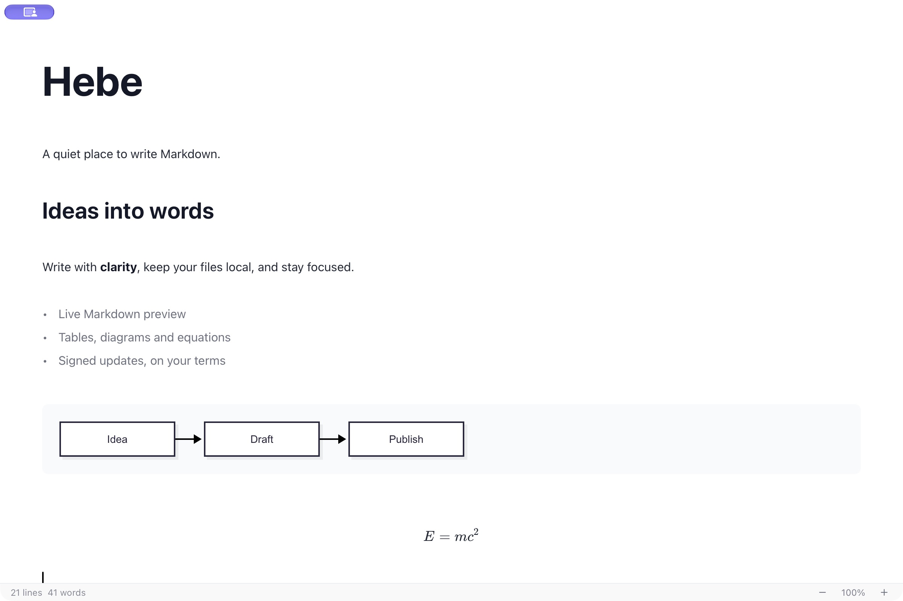

# Hebe

**A quiet place to write Markdown.**

Hebe is a lightweight, open-source desktop Markdown editor inspired by Typora. Read a clean document, click to edit its source, and keep your work in ordinary local Markdown files.

[Download for macOS](https://github.com/Hong1495/Hebe/releases/latest) · [简体中文](README.zh-CN.md) · [Report an issue](https://github.com/Hong1495/Hebe/issues) · [Architecture](docs/architecture.md)



## Write without switching contexts

- **Live Markdown editing** — headings, lists, quotes, links and emphasis render in place; source mode is one shortcut away.
- **Technical writing** — editable tables, fenced code, Mermaid diagrams and KaTeX math.
- **Local files first** — open files from Finder or drag them in, paste images into an adjacent `assets/` folder, and work across multiple tabs.
- **A focused workspace** — native menus, optional outline, light/dark/system themes, focus mode and typewriter mode.
- **Safer editing** — saved files auto-save after three seconds; closing or quitting checks unsaved changes. Tabs retain undo history, selection and scroll position during the session.
- **Share your work** — export PDF, DOCX, HTML and EPUB with Pandoc, including rendered Mermaid diagrams.
- **In-app updates** — an orange indicator beside the macOS window controls, release-note popover, automatic checks, signed downloads and explicit restart, inspired by [Bee](https://github.com/Hong1495/Bee).

## Install

The current release, **v1.1.1**, supports **Apple Silicon Macs running macOS 13 or later**. Intel macOS, Windows and Linux binaries are not provided in this release.

1. Download `Hebe_1.1.1_aarch64.dmg` from [Releases](https://github.com/Hong1495/Hebe/releases/latest).
2. Open the DMG and drag **Hebe.app** into **Applications**. Launch the installed copy, not the read-only disk image.
3. This release is ad-hoc signed, without Apple Developer ID signing or notarization. If macOS blocks it, use **System Settings → Privacy & Security → Open Anyway** after reviewing the source and release checksums.

Choose **Hebe → Check for Updates…** or **Settings → Updates** to check manually. Menu checks run in the background without opening Settings or a popover; when an update is available, click the orange indicator to view it. Automatic checks can be disabled; they never install an update without your action. The update signature protects downloaded packages and is separate from Apple notarization.

## Export dependencies

Editing needs no additional tools. Export uses [Pandoc](https://pandoc.org/installing.html); PDF also needs [MacTeX/BasicTeX](https://www.tug.org/mactex/) or TeX Live with `xelatex` and the required LaTeX packages. The macOS PDF template uses PingFang SC for Chinese text.

```bash
brew install pandoc
brew install --cask basictex
```

Exports are written beside the source document using the selected extension; an existing same-name export is replaced. Relative image paths resolve from the document folder. Documents must be saved before export or image paste.

## Keyboard shortcuts

| Action | macOS shortcut |
| --- | --- |
| New / Open / Save | ⌘N / ⌘O / ⌘S |
| Bold / Italic / Link | ⌘B / ⌘I / ⌘K |
| Find / Replace | ⌘F / ⌘⌥F |
| Source mode | ⌘/ |
| Outline | ⌘⇧B |
| Settings | ⌘, |

## Development

Built with **Tauri 2, React 19, TypeScript, CodeMirror 6 and Rust**. On macOS, install Xcode Command Line Tools, a current stable Rust toolchain and Node.js 22.12+ (Node 24 LTS recommended).

```bash
npm ci
npm run tauri:dev
```

```bash
npm test
npm run build
cargo test --manifest-path src-tauri/Cargo.toml
```

`npm run dev` runs the browser editor preview; native file operations, menus and updates require Tauri. See [architecture](docs/architecture.md) and [release instructions](docs/releases.md) for implementation and signed packaging.

## Scope and data

Hebe edits local files without an account or cloud sync. Automatic update checks contact GitHub and can be turned off. Remote image URLs in a document may contact their hosts. Recent file paths and preferences stay on the device.

The current release restores the most recent file at launch; it does not persist unsaved drafts or undo history across app restarts. MDX files can be opened as text, but JSX components are not executed. Export appearance follows Pandoc templates rather than exactly matching the editor.

## Contributing

Bug reports and focused pull requests are welcome. For editor issues, include a small Markdown sample, macOS version and steps to reproduce. Please run the checks above and preserve the compact, document-first interface. See [CONTRIBUTING.md](CONTRIBUTING.md).

## License

[MIT](LICENSE). Built on excellent open-source projects; see [third-party notices](THIRD_PARTY_NOTICES.md).
