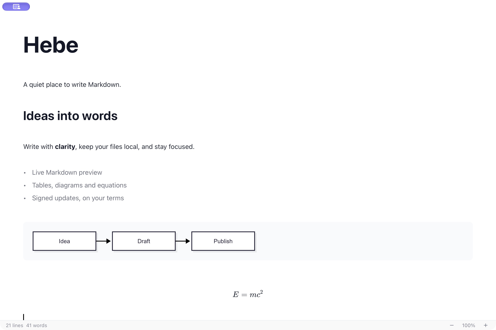

<p align="center">
  
</p>

# Hebe

**安静、轻量的桌面 Markdown 写作工具。**

Hebe 是一款受 Typora 启发的开源 Markdown 编辑器：平时阅读排版后的文档，点击即可编辑源码，内容始终保存在本地 Markdown 文件中。

[下载 macOS 版本](https://github.com/Hong1495/Hebe/releases/latest) · [English](README.md) · [反馈问题](https://github.com/Hong1495/Hebe/issues)



## 功能

- 即时预览与源码模式，支持标题、列表、引用、链接、强调等常见 Markdown 语法。
- 可编辑表格、代码块、Mermaid 图表、KaTeX 数学公式与本地图片粘贴。
- 多标签编辑，同一会话内保留撤销历史、光标和滚动位置。
- 原生菜单、可选大纲、深浅主题、专注模式与打字机模式。
- 每个标签独立自动保存，支持原子写入、外部修改冲突提示、保存失败提示与未命名草稿恢复。
- 脚注跳转、正文 `[toc]` 目录、YAML Front Matter，以及图片插入、替换与描述编辑。
- 通过 Pandoc 导出 PDF、DOCX、HTML、EPUB，选择保存位置；PDF 支持纸张、字号、页边距、目录和章节编号。
- 参考 Bee 实现签名升级：窗口红黄绿按钮旁的等间距橙色圆点、版本说明浮层、自动检查、手动下载安装、确认后重启。

## 安装

当前版本 **v1.2.1** 支持 **Apple Silicon Mac，macOS 13 及以上**，暂不提供 Intel Mac、Windows 或 Linux 安装包。

1. 从 [Releases](https://github.com/Hong1495/Hebe/releases/latest) 下载 DMG。
2. 将 Hebe.app 拖入 Applications，从安装位置启动；不要直接在只读 DMG 中使用升级功能。
3. 本版本为 ad-hoc 签名，未经过 Apple Developer ID 签名和公证。如被 macOS 阻止，在确认来源和校验文件后，通过「系统设置 → 隐私与安全性 → 仍要打开」启动。

菜单「Hebe → Check for Updates…」和「Settings → Updates」可手动检查升级。菜单检查在后台进行，不会自动弹出设置或升级浮层；发现更新后可点击橙色圆点查看。自动检查可以关闭，发现新版本后不会自动安装。更新包签名与 Apple 公证是两回事。

## 导出

日常编辑无需安装额外工具。导出需要 [Pandoc](https://pandoc.org/installing.html)，PDF 还需要 XeLaTeX（MacTeX / BasicTeX / TeX Live 及所需宏包，包含用于长代码折行的 `fvextra`）。中文 PDF 使用系统苹方字体。

```bash
brew install pandoc
brew install --cask basictex
```

导出时通过系统保存对话框选择目标位置，覆盖已有文件需确认。PDF 可选择 A4 / Letter、10–12 pt 字号、10–40 mm 页边距、目录与章节编号。导出失败会保留已有目标文件。相对图片路径按文档目录解析。导出与图片插入前需先保存文档。

## 长文写作与保存

在独立一行输入 `[toc]` 生成可点击目录；使用 `[^note]` 与 `[^note]: 内容` 编写脚注，续行缩进四个空格。文档开头以 `---` 包围的 YAML 元数据保留原样并显示为可编辑块。菜单 **Format** 提供目录、脚注和图片插入；图片悬停后可替换或编辑描述与路径。

已保存文件停止输入三秒后自动保存，切换标签不会取消其他标签的保存。检测到外部修改时，干净标签自动更新，存在本地编辑的标签暂停自动保存并提供查看磁盘副本、另存副本和确认覆盖入口。关闭或退出仍会询问未保存内容。写入使用临时文件替换，保留权限及符号链接；跨应用同时写入无法形成全局锁，仍建议避免两个编辑器同时保存同一文件。

## 开发

技术栈：Tauri 2、React 19、TypeScript、CodeMirror 6、Rust。需要 Xcode 命令行工具、当前稳定版 Rust 和 Node.js 22.12+，推荐 Node 24 LTS。

```bash
npm ci
npm run tauri:dev
npm test
npm run build
cargo test --manifest-path src-tauri/Cargo.toml
```

浏览器预览使用 `npm run dev`，文件操作、原生菜单和升级需在 Tauri 中运行。参阅[架构说明](docs/architecture.md)与[发布流程](docs/releases.md)。

## 当前边界

无需账号，不提供云同步。更新检查访问 GitHub；文档中的远程图片可能访问图片服务器。最近文件路径与偏好设置保存在本机。

启动时恢复上次打开的标签及未命名草稿；无恢复记录时尝试打开最近文件。草稿保存在本机 WebView 存储，空间不足会显示提示；清除应用数据也会删除草稿。撤销历史不跨重启保存。MDX 作为文本编辑，不执行 JSX。导出排版由 Pandoc 模板决定，不保证与编辑器完全一致。

欢迎提交包含最小 Markdown 样例和复现步骤的 Issue。采用 [MIT 许可证](LICENSE)。
