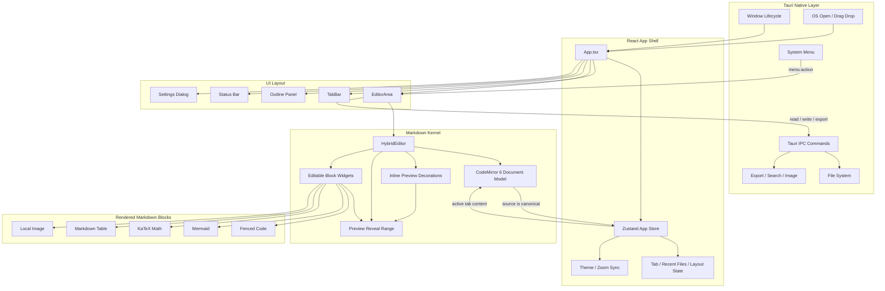

## App Architecture

```text
src/
  App.tsx                         App shell, theme sync, drag/open events
  stores/app-store.ts             Zustand state: tabs, layout, theme, zoom, recent files
  components/layout/              Tab bar, editor area, outline panel, status bar, settings
  components/editor/HybridEditor  CodeMirror 6 host and extension wiring
  components/editor/extensions/   Markdown preview engine and block widgets
  lib/ipc.ts                      Typed Tauri command wrappers
src-tauri/
  src/lib.rs                      Tauri builder, native menu, window lifecycle, OS open events
  src/commands/                   File IO, export, image paste, outline extraction
```

The frontend owns editor state and interaction. The Rust side owns native shell
integration, filesystem access, export commands, image paste, app menus, and macOS
open/reopen behavior.


## Markdown Kernel

The Markdown kernel is a CodeMirror 6 hybrid renderer. It does not convert the
document into a separate HTML preview; the source text remains the canonical
model at all times.

Core pieces:

- `HybridEditor.tsx` wires the editor state, keymaps, markdown highlighting,
  preview extensions, paste handling, and block widgets.
- `hybrid-preview.ts` provides inline preview decorations and reveal state.
  Markdown markers are hidden in preview mode, but the active/revealed line
  shows raw source for editing.
- `block-widgets.ts` replaces larger Markdown blocks with editable widgets:
  fenced code, Mermaid, KaTeX block math, images, and tables.
- `previewRevealRangeField` coordinates source reveal across inline decorations
  and block widgets.
- Click reveal happens on `mousedown` for unrevealed lines, which prevents
  CodeMirror from briefly selecting the wrong nearby widget before the intended
  line enters edit mode.

Supported preview behavior:

- Headings, emphasis, strong text, strikethrough, inline code, links.
- Block quotes, lists, task lists, horizontal rules.
- Fenced code blocks isolated from Markdown re-parsing.
- Mermaid fenced blocks rendered through Mermaid with source fallback.
- Inline and block math through KaTeX.
- Markdown tables rendered as editable table widgets.
- Local images resolved relative to the Markdown file path.

Important engine constraints:

- Fenced code blocks are isolation boundaries. Inline Markdown scanners must not
  run inside them.
- Widgets must be editable. A click should reveal the original source range and
  place the cursor near the user's click target.
- Preview decorations should be cheap. Inline scanning is capped by line length,
  and block scanning skips already-classified ranges.
- Source remains the source of truth. Generated widget DOM must never become
  canonical document state.

## Native Integration

- System menus emit `menu-action` events consumed by the editor area.
- Close hides the main window instead of quitting; reopen restores/focuses it.
- Startup and macOS file-open events are queued through `take_pending_open_files`.
- Recent files are restored on launch; missing recent paths are pruned.
- Auto-save runs after a short debounce for saved files.
- External file changes are detected by mtime polling when the current tab is
  clean.

